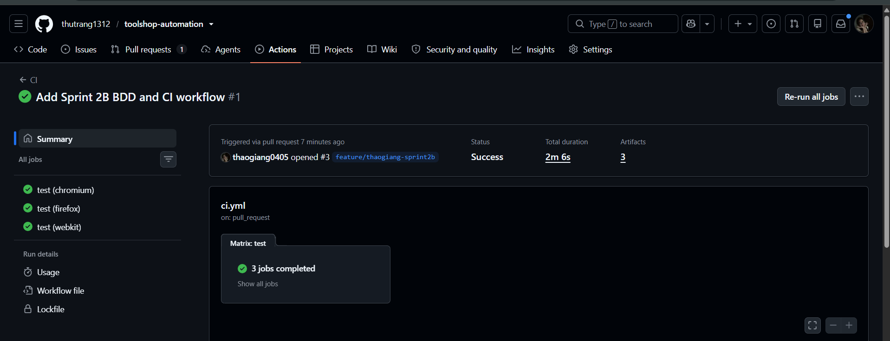
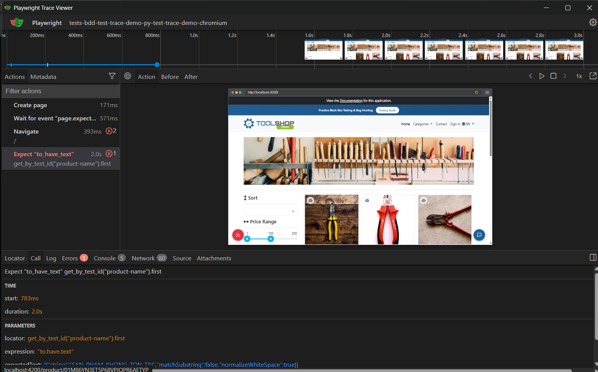

# Toolshop Automation


## Giới thiệu

Dự án kiểm thử tự động website Toolshop bằng Python, Pytest và Playwright.

Dự án bao gồm:
- Kiểm thử API.
- Kiểm thử giao diện (UI).
- Kiểm thử BDD bằng Gherkin và pytest-bdd.
- Kiểm thử tự động bằng GitHub Actions.

## Kiểm thử BDD

Kịch bản BDD kiểm tra luồng nghiệp vụ thêm sản phẩm vào giỏ hàng và xác minh giá tiền.

Feature sử dụng Scenario Outline và Examples với hai trường hợp:
- Combination Pliers — số lượng 1.
- Claw Hammer — số lượng 3.

Chạy kiểm thử BDD:

```bash
python -m pytest tests/bdd -v
```

Kết quả trên máy cá nhân: **2 passed**.

## Kiểm thử toàn bộ dự án

```bash
python -m pytest -v
```

Kết quả trên Toolshop local: **26 passed**.

## GitHub Actions

CI được cấu hình tự động chạy trên ba trình duyệt:

- Chromium
- Firefox
- WebKit

Workflow hỗ trợ push vào main, Pull Request và chạy thủ công.

### Kết quả CI


```
## GitHub Actions

CI được cấu hình tự động chạy trên ba trình duyệt:

- Chromium
- Firefox
- WebKit

Workflow hỗ trợ push vào main, Pull Request và chạy thủ công.

### Kết quả CI


### Trace Viewer

